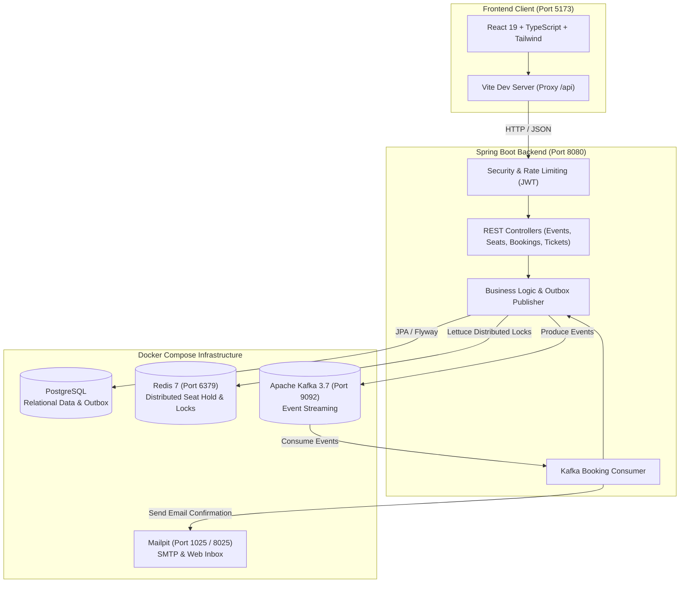

# 🎟️ VENU — Smart Event Management & Ticketing Platform

[](https://spring.io/projects/spring-boot)
[](https://openjdk.org/)
[](https://react.dev/)
[](https://www.typescriptlang.org/)
[](https://vitejs.dev/)
[](https://tailwindcss.com/)
[](https://www.postgresql.org/)
[](https://redis.io/)
[](https://kafka.apache.org/)
[](https://www.docker.com/)

> **VENU** is an enterprise-grade, high-concurrency event management and ticketing platform designed to handle massive ticket rushes. Featuring temporary distributed seat holds via Redis, transactional outbox messaging with Apache Kafka, cryptographic QR code check-in, automated email dispatch, and a modern, fluid React 19 interface.

---

## 📑 Table of Contents

- [✨ Key Features](#-key-features)
- [🏗️ System Architecture](#️-system-architecture)
- [🧰 Tech Stack](#-tech-stack)
- [📋 Prerequisites](#-prerequisites)
- [🚀 Quick Start Tutorial](#-quick-start-tutorial)
  - [Step 1: Start Docker Infrastructure](#step-1-start-docker-infrastructure)
  - [Step 2: Run the Backend Application](#step-2-run-the-backend-application)
  - [Step 3: Install Node Modules & Run Frontend](#step-3-install-node-modules--run-frontend)
- [🌐 Service & Port Cheat Sheet](#-service--port-cheat-sheet)
- [📡 API Documentation & Endpoints](#-api-documentation--endpoints)
- [📂 Project Structure](#-project-structure)
- [🛠️ Troubleshooting & FAQ](#️-troubleshooting--faq)
- [📄 License](#-license)

---

## ✨ Key Features

- **⚡ Redis Distributed Seat Hold**: Temporary 5-minute seat locking preventing race conditions and double bookings during high-demand sales.
- **🛡️ Idempotent Booking Engine**: Eliminates duplicate charges and transactions using client-generated idempotency keys.
- **📦 Transactional Outbox Pattern**: Decoupled messaging using Apache Kafka ensuring guaranteed at-least-once delivery of booking events.
- **📱 Cryptographic QR Tickets**: Generates secure QR tokens for booked tickets with instant organizer check-in and tamper detection.
- **📬 Local Email Preview (Mailpit)**: Zero external SMTP setup required; preview verification and ticket confirmation emails in an interactive web UI.
- **📊 Real-Time Organizer Analytics**: Interactive dashboards for revenue metrics, attendance rates, and seat occupancy percentages.
- **🔐 Enterprise Security & RBAC**: JWT-based stateless authentication with granular roles (`ROLE_ATTENDEE`, `ROLE_ORGANIZER`, `ROLE_ADMIN`) and request rate limiting.
- **🎨 Modern Responsive UI**: Crafted with React 19, TypeScript, Tailwind CSS, Lucide icons, and Lenis smooth scrolling.

---

## 🏗️ System Architecture



---

## 🧰 Tech Stack

| Layer | Technology | Purpose |
| :--- | :--- | :--- |
| **Frontend** | React 19, TypeScript, Vite 8, Tailwind CSS | High-performance SPA with smooth interactions & seat maps |
| **Icons & Style** | Lucide React, Lenis Scroll | Modern visual design and smooth scroll animations |
| **Backend** | Spring Boot 3.2.5, Java 21 | High-throughput, robust REST API server |
| **Security** | Spring Security 6, JJWT (0.12.5), BCrypt | Stateless JWT authorization and role-based permissions |
| **Primary Database** | PostgreSQL, Hibernate, Spring Data JPA | Relational data persistence with Flyway migrations |
| **Distributed Caching** | Redis 7 (Alpine), Lettuce Driver | 5-minute seat reservations and rate limiting |
| **Event Streaming** | Apache Kafka 3.7.0 (KRaft Mode) | Asynchronous booking events & Transactional Outbox |
| **QR Code Engine** | Google ZXing (3.5.2) | Generation & verification of check-in QR codes |
| **Mail Testing** | Mailpit (axllent/mailpit) | Local SMTP server and web mail inspection |
| **API Docs** | Springdoc OpenAPI (Swagger UI) | Interactive REST API documentation |

---

## 📋 Prerequisites

Before running the project, ensure you have the following installed on your system:

- [x] **Docker Desktop** (or Docker Engine + Docker Compose v2.0+)
- [x] **Java Development Kit (JDK 21)** (e.g., OpenJDK, Eclipse Temurin)
- [x] **Node.js** (v18.x, v20.x, or v22.x LTS)
- [x] **npm** (comes with Node.js) or **pnpm** / **yarn**

---

## 🚀 Quick Start Tutorial

Follow these 3 easy steps to get the entire system up and running:

### Step 1: Start Docker Infrastructure

The project includes a ready-to-run `docker-compose.yml` configuring MySQL, Redis, Apache Kafka, and Mailpit.

1. Open your terminal in the project root directory:
   ```bash
   cd VENU
   ```

2. Start all services in detached mode:
   ```bash
   docker compose up -d
   ```

3. Verify all 4 containers are running and healthy:
   ```bash
   docker compose ps
   ```

   You should see:
   | Container Name | Service | Ports | Status |
   | :--- | :--- | :--- | :--- |
   | `ems-mysql` | MySQL 8.0 | `0.0.0.0:3306->3306/tcp` | Up (healthy) |
   | `ems-redis` | Redis 7 | `0.0.0.0:6379->6379/tcp` | Up (healthy) |
   | `ems-kafka` | Apache Kafka 3.7 | `0.0.0.0:9092->9092/tcp` | Up (healthy) |
   | `ems-mailpit` | Mailpit Web UI & SMTP | `1025->1025`, `8025->8025` | Up |

> [!TIP]
> **Helpful Docker Commands**:
> - View logs: `docker compose logs -f`
> - Stop services: `docker compose down`
> - Reset all databases/volumes: `docker compose down -v`

---

### Step 2: Run the Backend Application

The backend is built with Spring Boot 3.2.5 and automatically executes database migrations via Flyway upon launch.

1. Ensure your Docker containers are running (especially MySQL and Kafka).
2. Run the application from the root directory using the included Maven wrapper:

   **On Windows (PowerShell / CMD):**
   ```powershell
   .\mvnw.cmd spring-boot:run
   ```

   **On macOS / Linux:**
   ```bash
   ./mvnw spring-boot:run
   ```

   *(Or if you have Maven installed globally, simply run: `mvn spring-boot:run`)*

3. **Verify the Backend**:
   - Backend Server: `http://localhost:8080`
   - Health Check: [http://localhost:8080/actuator/health](http://localhost:8080/actuator/health) (should return `{"status":"UP"}`)
   - Interactive Swagger API Docs: [http://localhost:8080/swagger-ui.html](http://localhost:8080/swagger-ui.html)

---

### Step 3: Install Node Modules & Run Frontend

The React + TypeScript application is located inside the `frontend/frontend` folder.

1. Navigate to the frontend app directory:
   ```bash
   cd frontend/frontend
   ```

2. Install all required dependencies (node modules):
   ```bash
   npm install
   ```

3. Start the Vite development server:
   ```bash
   npm run dev
   ```

4. Open your browser and visit:
   ```
   http://localhost:5173
   ```

> [!NOTE]
> The Vite development server comes pre-configured with an automatic proxy in `vite.config.ts`. All API calls to `/api/*` are transparently proxied to `http://localhost:8080`, avoiding CORS headaches during development.

---

## 🌐 Service & Port Cheat Sheet

| Service | Port | Accessible URL | Credentials / Notes |
| :--- | :--- | :--- | :--- |
| **Frontend Web App** | `5173` | [http://localhost:5173](http://localhost:5173) | Vite + React 19 Client |
| **Backend REST API** | `8080` | [http://localhost:8080](http://localhost:8080) | Spring Boot REST API |
| **Swagger / OpenAPI** | `8080` | [http://localhost:8080/swagger-ui.html](http://localhost:8080/swagger-ui.html) | Interactive API Explorer |
| **Spring Boot Actuator** | `8080` | [http://localhost:8080/actuator](http://localhost:8080/actuator) | System Metrics & Health |
| **Mailpit Web Mail** | `8025` | [http://localhost:8025](http://localhost:8025) | View sent confirmation emails |
| **Mailpit SMTP** | `1025` | `localhost:1025` | Spring Boot Mail Sender |
| **PostgreSQL Database** | `5432` | `jdbc:postgresql://localhost:5432/projectsmart` | User: `postgres` \| Pass: `postgres` (or Render Managed PostgreSQL) |
| **Redis Cache** | `6379` | `localhost:6379` | Default No-Auth |
| **Apache Kafka Broker** | `9092` | `localhost:9092` | KRaft Mode (Broker & Controller) |

---

## 📡 API Documentation & Endpoints

Access the full interactive documentation at **[http://localhost:8080/swagger-ui.html](http://localhost:8080/swagger-ui.html)**. Here is an overview of the key endpoints:

### 🔐 Authentication (`/api/auth`)
| Method | Endpoint | Description | Auth Required |
| :--- | :--- | :--- | :--- |
| `POST` | `/api/auth/register` | Register a new user | Public |
| `POST` | `/api/auth/login` | Authenticate user and receive JWT | Public |
| `GET` | `/api/auth/me` | Get profile of currently logged-in user | `Bearer Token` |

### 🎪 Events (`/api/events`)
| Method | Endpoint | Description | Auth Required |
| :--- | :--- | :--- | :--- |
| `GET` | `/api/events` | Search and filter events (category, date, city) | Public |
| `GET` | `/api/events/{id}` | Retrieve event details | Public |
| `POST` | `/api/events` | Create a new event | `ROLE_ORGANIZER`, `ROLE_ADMIN` |
| `PUT` | `/api/events/{id}` | Update existing event | `ROLE_ORGANIZER`, `ROLE_ADMIN` |

### 💺 Seats & Real-Time Holds (`/api/events/{eventId}/seats`)
| Method | Endpoint | Description | Auth Required |
| :--- | :--- | :--- | :--- |
| `GET` | `/api/events/{eventId}/seats` | Fetch real-time seat layout and status | Public / Optional Auth |
| `POST` | `/api/events/{eventId}/seats/hold` | Hold seat(s) for 5 minutes (Redis Lock) | `Bearer Token` |
| `POST` | `/api/events/{eventId}/seats/release`| Manually release held seat(s) | `Bearer Token` |

### 🎫 Bookings (`/api/bookings`)
| Method | Endpoint | Description | Auth Required |
| :--- | :--- | :--- | :--- |
| `POST` | `/api/bookings` | Confirm booking with idempotency key | `Bearer Token` |
| `GET` | `/api/bookings/my-bookings` | Paginated list of current user's bookings | `Bearer Token` |
| `GET` | `/api/bookings/{reference}` | Retrieve booking receipt & tickets | `Bearer Token` |

### 📲 Tickets & Check-in (`/api/tickets`)
| Method | Endpoint | Description | Auth Required |
| :--- | :--- | :--- | :--- |
| `GET` | `/api/tickets/booking/{reference}` | Get tickets with QR code representations | `Bearer Token` |
| `POST` | `/api/tickets/check-in` | Scan & validate attendee ticket at venue | `ROLE_ORGANIZER`, `ROLE_ADMIN` |
| `GET` | `/api/tickets/verify/{qrOrCode}` | Verify ticket authenticity | `Bearer Token` |

### 📊 Organizer Analytics (`/api/analytics`)
| Method | Endpoint | Description | Auth Required |
| :--- | :--- | :--- | :--- |
| `GET` | `/api/analytics` | Get aggregated revenue, orders & attendance stats | `ROLE_ORGANIZER`, `ROLE_ADMIN` |

---

## 📂 Project Structure

```text
VENU/
├── docker-compose.yml              # Multi-container setup (MySQL, Redis, Kafka, Mailpit)
├── pom.xml                         # Maven dependencies & build configuration (Java 21)
├── mvnw / mvnw.cmd                 # Cross-platform Maven wrapper scripts
├── src/
│   ├── main/
│   │   ├── java/com/project/event_management_system/
│   │   │   ├── config/             # Security, Kafka, and Redis configurations
│   │   │   ├── consumer/           # Kafka event consumers (BookingEventConsumer)
│   │   │   ├── controller/         # REST API Controllers (Auth, Events, Bookings, etc.)
│   │   │   ├── dto/                # Request and Response Data Transfer Objects
│   │   │   ├── model/              # JPA Entities (User, Event, Seat, Booking, Ticket)
│   │   │   ├── repository/         # Spring Data JPA Repositories
│   │   │   ├── security/           # JWT Provider, Auth Filters & Rate Limiter
│   │   │   └── service/            # Core business logic, SeatHoldService, QrCodeService
│   │   └── resources/
│   │       ├── db/migration/       # Flyway SQL migrations (V1__init_schema.sql)
│   │       └── application.yml     # Spring Boot application properties
│   └── test/                       # Unit & Testcontainers integration tests
└── frontend/
    └── frontend/                   # React 19 Client Application
        ├── package.json            # Node modules & frontend dependencies
        ├── vite.config.ts          # Vite build config & backend API reverse-proxy
        ├── index.html              # Single Page Application entry point
        └── src/
            ├── api/                # Axios HTTP client & API service calls
            ├── components/         # Reusable UI widgets & Navbar
            ├── context/            # React context (Auth state)
            └── pages/              # Pages (Events, EventDetails, Bookings, Analytics)
```

---

## 🛠️ Troubleshooting & FAQ

### 1. `Port 3306 / 6379 / 8080 already in use`
- If you have an existing local instance of MySQL or Redis running, either stop that local service or edit `docker-compose.yml` to map to an alternate external port (e.g., `"3307:3306"`).
- Update the matching port in `src/main/resources/application.yml`.

### 2. Kafka container startup delays
- Apache Kafka in KRaft mode may take 15–20 seconds to establish quorum on first boot. Check health with:
  ```bash
  docker compose ps
  ```
  Wait until `ems-kafka` shows `(healthy)` before starting the backend application.

### 3. Backend fails with database connection error
- Ensure the MySQL container is healthy and ready to accept connections:
  ```bash
  docker compose logs ems-mysql
  ```
- Flyway will automatically execute `V1__init_schema.sql` on the first successful start.

### 4. Emails are not arriving in real inbox
- By design, all outgoing emails are intercepted safely by **Mailpit** to prevent accidental external spam.
- View all simulated confirmation emails instantly at [http://localhost:8025](http://localhost:8025).

---

## 👨‍💻 Development Scripts Summary

| Task | Command | Directory |
| :--- | :--- | :--- |
| **Start Docker stack** | `docker compose up -d` | Root (`VENU/`) |
| **Stop Docker stack** | `docker compose down` | Root (`VENU/`) |
| **Run Backend** | `.\mvnw.cmd spring-boot:run` *(Windows)*<br>`./mvnw spring-boot:run` *(macOS/Linux)* | Root (`VENU/`) |
| **Install Frontend Node Modules** | `npm install` | `frontend/frontend/` |
| **Run Frontend Dev Server** | `npm run dev` | `frontend/frontend/` |
| **Build Frontend for Production** | `npm run build` | `frontend/frontend/` |

---

## 📄 License

This project is licensed under the MIT License - see the LICENSE file for details.

